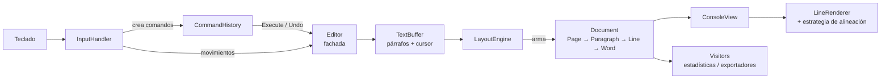

# Editor de Texto por Consola en C#

Editor de texto que corre en la terminal, hecho en C# (.NET 9) como trabajo práctico de Programación Orientada a Objetos. El objetivo es representar un documento separado en **páginas, párrafos, líneas y palabras**, y aplicar sobre esa estructura los patrones de diseño clásicos (GoF): **Composite, Strategy, Command y Visitor**.

```
 Página 1/1 · Línea 1/7 · Alineación: Justificado
+--------------------------------------------------+
|Estamos  haciendo  un  editor  de  texto. Queremos|
|representar  un  documento de manera tal que pueda|
|estar  separado en páginas, en párrafos, en líneas|
|y en palabras.                                    |
|                                                  |
|Probá  escribir,  borrar,  mover el cursor con las|
|flechas y cambiar la alineación con F1 a F4.      |
+--------------------------------------------------+
 Palabras: 43 · Caracteres: 210 · Líneas: 7 · Párrafos: 3 · Páginas: 1
```

---

## Índice

- [Funcionalidades](#funcionalidades)
- [Cumplimiento de la consigna](#cumplimiento-de-la-consigna)
- [Requisitos](#requisitos)
- [Cómo ejecutarlo](#cómo-ejecutarlo)
- [Controles](#controles)
- [Reglas de edición](#reglas-de-edición)
- [Arquitectura](#arquitectura)
- [Patrones de diseño](#patrones-de-diseño)
- [Documentación de las clases](#documentación-de-las-clases)
- [Estructura del proyecto](#estructura-del-proyecto)
- [Configuración](#configuración)
- [Decisiones de diseño](#decisiones-de-diseño)
- [Rendimiento](#rendimiento)

---

## Funcionalidades

- **Edición de texto**: escribir, borrar con Backspace y Supr, partir párrafos con Enter y unirlos al borrar el salto.
- **Corte de líneas automático** a un ancho fijo, sin cortar nunca una palabra a la mitad.
- **Paginación**: las líneas se agrupan en páginas, con un separador visible entre una y otra.
- **Cuatro alineaciones**: izquierda, derecha, centrado y justificado.
- **Deshacer** (Ctrl+Z) de cualquier edición y de los cambios de alineación.
- **Navegación** con flechas (incluso entre líneas visuales), Inicio y Fin.
- **Vista reducida**: solo se muestran las líneas alrededor del cursor, que se desplazan para que el cursor siempre se vea.
- **Estadísticas en vivo**: palabras, caracteres, líneas, párrafos y páginas.
- **Exportación** a texto plano (`.txt`, tal como se ve en pantalla) y a Markdown (`.md`).

## Cumplimiento de la consigna

| Requisito | Dónde se resuelve |
|---|---|
| Documento separado en páginas, párrafos, líneas y palabras | Composite: `Document` → `Page` → `Paragraph` → `Line` → `Word` |
| Contar palabras y páginas (estadísticas) | Visitor: `StatisticsVisitor` (también cuenta caracteres, líneas y párrafos) |
| Alinear a izquierda, derecha, centrado y justificado | Strategy: `LeftAlignment`, `RightAlignment`, `CenterAlignment`, `JustifiedAlignment` |
| Exportar a distintos formatos en el futuro | Visitor: `PlainTextExporter` y `MarkdownExporter`; un formato nuevo es un visitor nuevo |
| Uso por CLI con ancho fijo de caracteres por línea, contando espacios y separaciones del justificado | `EditorConfig.LineWidth`; `LineRenderer` siempre devuelve líneas de exactamente ese ancho |
| Las palabras nunca se cortan, solo cambian de línea | `LayoutEngine` (corte *greedy* por palabras) + reglas de `Editor` que impiden palabras más largas que el ancho |
| Agregar y eliminar caracteres en la posición del cursor, donde sea | `TextBuffer` + comandos `InsertCharCommand`, `DeleteBeforeCommand`, `DeleteAfterCommand`, `SplitParagraphCommand` |
| No colgarse con cada tecleo, incluso con documentos grandes | Ver [Rendimiento](#rendimiento) |
| Vista reducida, mover el cursor, teclear, borrar, cambiar alineación y ver estadísticas en consola | `ConsoleView` + `InputHandler` |
| Deshacer con Ctrl+Z | Command: `CommandHistory` + un comando por cada operación de edición |
| Documentar cada clase con su responsabilidad e ítem de cambio | Comentario `/// <summary>` al inicio de cada clase (ver [Documentación de las clases](#documentación-de-las-clases)) |
| Al menos 3 patrones, con roles, justificación, pros y contras | [Patrones de diseño](#patrones-de-diseño): Composite, Strategy, Command y Visitor (más Facade) |
| Código tipado | C# es estáticamente tipado; además está activado `Nullable` para que el compilador controle los nulos |

## Reglas de edición

El editor mantiene el texto siempre limpio para que el maquetado sea predecible:

1. **No hay espacios al inicio de un párrafo.**
2. **No hay dos espacios seguidos.** Si se escribe un espacio justo antes de otro, el cursor avanza en lugar de duplicarlo, y lo que se escriba a continuación empieza una palabra nueva (por ejemplo, con el cursor en `hola|` delante de ` mundo`, tipear ` lindo` da `hola lindo mundo`).
3. **Ninguna palabra puede superar el ancho de línea.** Como las palabras nunca se cortan, una más larga no entraría en ninguna línea. Esto se controla al escribir y también al borrar un espacio o un salto de párrafo que uniría dos palabras. Si una acción no se puede hacer, la barra de estado explica por qué.

## Arquitectura

El programa separa el **texto** (lo que el usuario escribe) de su **forma** (cómo se reparte en líneas y páginas):



1. **`TextBuffer`** guarda el texto como una lista de párrafos y la posición lógica del cursor (párrafo + offset). No sabe nada de líneas ni páginas.
2. Después de cada cambio, el **`LayoutEngine`** reconstruye el árbol **`Document`** a partir del buffer: separa palabras, las acomoda en líneas (algoritmo *greedy*) y agrupa las líneas en páginas.
3. **`LineRenderer`** dibuja cada línea con la **estrategia de alineación** actual y traduce el offset del cursor a la columna donde se muestra.
4. **`ConsoleView`** arma el cuadro (encabezado, líneas visibles, estadísticas, ayuda) y lo dibuja sin `Console.Clear()`, para que no parpadee.
5. **`InputHandler`** traduce cada tecla en un comando (si es una edición) o en un movimiento del cursor.

## Patrones de diseño

Los roles de cada patrón siguen los nombres de *Design Patterns* (Gamma, Helm, Johnson y Vlissides, "GoF") y de [Refactoring Guru](https://refactoring.guru/es/design-patterns). Cada clase que participa de un patrón lo dice también en su comentario (`Patrón X — rol: Y`).

| Patrón | Tipo (GoF) | Para qué se usa |
|---|---|---|
| Composite | Estructural | Representar el documento como jerarquía de páginas, párrafos, líneas y palabras |
| Strategy | De comportamiento | Las cuatro alineaciones intercambiables |
| Command | De comportamiento | Las ediciones y el deshacer con Ctrl+Z |
| Visitor | De comportamiento | Estadísticas y exportación a distintos formatos |
| Facade | Estructural | `Editor` como punto de entrada único al modelo |

### Composite — estructura del documento (`Structure/`)

El documento es un árbol de cuatro niveles:

```
Document
└── Page
    └── Paragraph
        └── Line
            └── Word   (hoja)
```

| Rol | Clase |
|---|---|
| Component | `DocumentElement` |
| Composite (base genérica) | `CompositeElement<TChild>` |
| Composites | `Document`, `Page`, `Paragraph`, `Line` |
| Leaf | `Word` |

`CompositeElement<TChild>` usa un parámetro genérico para que **el compilador impida armar árboles inválidos**: una `Line` solo acepta `Word`, una `Page` solo acepta `Paragraph`, etc. Si un párrafo cruza un salto de página, queda en dos nodos `Paragraph` con el mismo índice; el segundo se marca con `IsContinuation = true`.

**Por qué este patrón.** La intención del Composite según el GoF es *componer objetos en estructuras de árbol para representar jerarquías parte-todo, y que los clientes traten de manera uniforme a los objetos individuales y a los compuestos*. La consigna describe exactamente una jerarquía parte-todo (un documento tiene páginas, que tienen párrafos, que tienen líneas, que tienen palabras), y las operaciones que pide (contar, exportar, dibujar) necesitan recorrerla entera sin importar en qué nivel están.

**Pros (tal como lo usamos):**
- El árbol se recorre siempre igual, a través de `Children`, sin preguntar el tipo de cada nodo (`ToTreeString()` y los visitors lo aprovechan).
- Principio abierto/cerrado: se puede agregar un nivel nuevo (por ejemplo, `Section` entre `Document` y `Page`) sin cambiar a los clientes que recorren el árbol.
- Con el genérico `TChild` ganamos **seguridad de tipos**: un árbol inválido directamente no compila.

**Contras (tal como lo usamos):**
- El GoF plantea un compromiso entre *transparencia* (que `Add` esté en el Component y todos los nodos se vean iguales) y *seguridad* (que solo los compuestos tengan `Add`). Elegimos seguridad: `Add` está en `CompositeElement<TChild>` y no en `DocumentElement`, así que quien arma el árbol (el `LayoutEngine`) sí tiene que conocer los tipos concretos.
- Refactoring Guru advierte que una interfaz común para elementos muy distintos tiende a quedar demasiado general. Por eso `DocumentElement` solo tiene `Children`, `Describe` y `Accept`; los datos propios de cada nivel (offsets de `Line`, `Number` de `Page`) quedan en cada clase.
- El árbol se reconstruye completo después de cada cambio, lo cual es simple pero cuesta tiempo con documentos grandes (ver [Rendimiento](#rendimiento)).

### Strategy — alineación (`Layout/`)

| Rol | Clase |
|---|---|
| Strategy | `IAlignmentStrategy` |
| ConcreteStrategy | `LeftAlignment`, `RightAlignment`, `CenterAlignment`, `JustifiedAlignment` |
| Context | `LineRenderer` |

Cada estrategia devuelve un `LineSpacing`: cuántos espacios van antes de la primera palabra y cuántos entre cada par de palabras. `LineRenderer` no sabe qué alineación está usando. La alineación no cambia los cortes de línea, así que cambiarla no requiere volver a maquetar.

**Por qué este patrón.** El GoF define Strategy como *una familia de algoritmos, encapsulados cada uno y hechos intercambiables, para que el algoritmo varíe independientemente de los clientes que lo usan*. Las cuatro alineaciones son justamente variantes de un mismo algoritmo ("¿cuántos espacios van en esta línea?") y el usuario las cambia en tiempo de ejecución con F1–F4. Sin el patrón, `LineRenderer` tendría un `switch` por alineación repetido en `Render` y en `ColumnOf`.

**Pros (tal como lo usamos):**
- La alineación se cambia en tiempo de ejecución con solo reemplazar el objeto (`Editor.SetAlignment`).
- Se elimina el condicional: `LineRenderer` y `PlainTextExporter` funcionan con cualquier alineación sin saber cuál es.
- Cada algoritmo está aislado y se prueba por separado; agregar una alineación nueva es agregar una clase (abierto/cerrado).
- Como las estrategias devuelven números y no strings, la misma estrategia sirve para dibujar la línea y para ubicar el cursor, y nunca se contradicen.

**Contras (tal como lo usamos):**
- El cliente tiene que conocer las estrategias para elegir una: `InputHandler` crea `new LeftAlignment()`, etc.
- Son clases para algoritmos muy chicos (`LeftAlignment` es casi una línea). Refactoring Guru señala que en lenguajes con funciones de primera clase se podría resolver con delegados/lambdas; preferimos clases porque además cada una tiene un `Name` para mostrar.
- Comparar si la estrategia nueva es igual a la actual se hace por tipo (`GetType()`), porque las estrategias no tienen estado.

### Command — edición y deshacer (`Commands/`)

| Rol | Clase |
|---|---|
| Command | `IEditorCommand` |
| ConcreteCommand | `InsertCharCommand`, `DeleteBeforeCommand`, `DeleteAfterCommand`, `SplitParagraphCommand`, `ChangeAlignmentCommand` |
| Invoker | `CommandHistory` |
| Client | `InputHandler` |
| Receiver | `Editor` (y su `TextBuffer`) |

`Execute()` devuelve `true` solo si la operación cambió algo; así, por ejemplo, un Backspace al inicio del documento no ocupa lugar en el historial. Cada comando guarda lo necesario para revertirse exactamente, incluida la posición del cursor. Para los borrados, `TextBuffer` devuelve un `Deletion` que indica si se borró un carácter (y cuál) o un salto de párrafo.

Los **movimientos del cursor no son comandos** y no se deshacen, igual que en cualquier editor. La exportación tampoco, porque no modifica el documento.

**Por qué este patrón.** El GoF define Command como *encapsular una petición como un objeto, permitiendo parametrizar clientes con distintas peticiones, encolarlas o registrarlas, y soportar operaciones que se pueden deshacer*. El requisito de deshacer con Ctrl+Z es el caso de uso clásico del patrón: cada edición tiene que recordar lo suficiente para revertirse, y alguien tiene que guardar el orden en que ocurrieron.

**Pros (tal como lo usamos):**
- Deshacer queda resuelto de forma uniforme: `CommandHistory` apila comandos y llama a `Undo()` sin saber qué hace cada uno.
- Responsabilidad única: `InputHandler` decide *qué* operación corresponde a cada tecla, el comando sabe *cómo* hacerla y revertirla, y el `Editor` la ejecuta sobre el texto.
- Abierto/cerrado: una operación nueva (por ejemplo, pegar texto) es un comando nuevo, sin tocar el historial ni el resto.
- Las operaciones que fallan o no cambian nada (`Execute()` devuelve `false`) no ensucian el historial.
- Sería fácil agregar "rehacer" (una segunda pila) o comandos compuestos (macros), que Refactoring Guru menciona como ventajas.

**Contras (tal como lo usamos):**
- Más clases: una por cada tipo de operación.
- Cada `Undo()` depende de que el documento esté exactamente como lo dejó su `Execute()`. Funciona porque los comandos se deshacen en orden estricto de pila, pero un error ahí rompe el texto; por eso cada comando guarda la posición del cursor y lo que borró (`Deletion`).
- El historial guarda un objeto por cada tecla y no tiene límite; en una sesión muy larga crece sin parar (se podría acotar sin cambiar el resto, porque eso lo esconde `CommandHistory`).

### Visitor — operaciones sobre el documento (`Visitors/`)

| Rol | Clase |
|---|---|
| Visitor | `IDocumentVisitor` |
| ConcreteVisitor | `StatisticsVisitor`, `PlainTextExporter`, `MarkdownExporter` |
| Element | cada nodo del árbol, mediante `Accept(visitor)` |

Agregar una operación nueva (otro formato de exportación, otra métrica) es escribir una clase nueva, **sin tocar los nodos del documento**. Algunos detalles:

- `StatisticsVisitor` cuenta un párrafo partido entre páginas una sola vez.
- `PlainTextExporter` exporta el texto tal como se ve, con el ancho fijo, la alineación actual y una marca entre páginas.
- `MarkdownExporter` escribe cada párrafo en una sola línea (Markdown hace su propio corte) y vuelve a unir los párrafos partidos entre páginas.

**Por qué este patrón.** El GoF define Visitor como *representar una operación a realizar sobre los elementos de una estructura de objetos, permitiendo definir una operación nueva sin cambiar las clases de los elementos*. La consigna pide estadísticas y anticipa "exportar a distintos formatos en un futuro": son operaciones que se van a seguir agregando sobre una estructura (el Composite) que es estable. Visitor encaja justo en ese caso, y además se combina naturalmente con Composite, como indica el GoF.

**Pros (tal como lo usamos):**
- Abierto/cerrado para operaciones: un exportador nuevo (HTML, PDF) es una clase nueva y los nodos no se tocan.
- Responsabilidad única: todo lo de un formato vive junto en su visitor, en vez de repartido en un método `ToMarkdown()` en cada nodo.
- Un visitor puede acumular estado mientras recorre (los contadores de `StatisticsVisitor`, el párrafo actual de `MarkdownExporter`).
- *Double dispatch*: cada nodo llama al `Visit` de su tipo, así que no hay `if (nodo is Line)` en ningún lado.

**Contras (tal como lo usamos):**
- Si se agrega un tipo de nodo nuevo, hay que agregar un `Visit` en `IDocumentVisitor` y actualizar **todos** los visitors. Lo aceptamos porque la estructura del documento cambia mucho menos que las operaciones.
- Los visitors necesitan que los nodos expongan sus datos públicamente (`Words`, `IsContinuation`, `Number`), lo que debilita un poco el encapsulamiento.
- Cada visitor decide cómo recorrer los hijos, así que el código de recorrido se repite en los tres visitors; a cambio, cada uno puede recorrer a su manera (por ejemplo, `PlainTextExporter` no baja hasta las palabras).

### Facade — `Editor`

`Editor` es el punto de entrada al modelo. Junta el `TextBuffer`, el `LayoutEngine`, la alineación actual y el `Document`; vuelve a maquetar después de cada cambio y concentra las reglas de edición y la navegación por líneas visuales. El resto del programa (comandos, vista, input) habla solo con él.

- **Pro:** los comandos y la vista no dependen del `LayoutEngine` ni de cuándo hay que re-maquetar; esa regla está en un solo lugar.
- **Contra:** Refactoring Guru advierte que una fachada puede volverse un *objeto todopoderoso* acoplado a todo. `Editor` concentra bastante (reglas de edición y navegación), así que si creciera convendría separar, por ejemplo, la navegación en su propia clase.

## Documentación de las clases

Cada clase, interfaz, record y enum del proyecto tiene un comentario `/// <summary>` con dos partes:

- **Responsabilidad:** qué hace la clase.
- **Ítem de cambio que esconde:** qué decisión de diseño encapsula, es decir, qué se puede cambiar adentro sin afectar al resto del programa.

Ejemplo (`Model/TextBuffer.cs`):

```csharp
/// <summary>
/// Responsabilidad: guardar el texto del documento como una lista de párrafos
/// y la posición del cursor; insertar, borrar, partir y unir párrafos en el cursor.
/// Ítem de cambio que esconde: cómo se almacena el texto en memoria
/// (hoy una lista de StringBuilder; mañana podría ser un gap buffer o una rope
/// sin que el resto del programa se entere).
/// </summary>
public sealed class TextBuffer
```

## Estructura del proyecto

```
Editor_texto/
├── EditordeTexto.slnx            Solución
└── EditordeTexto/
    ├── Program.cs                Punto de entrada: arma los objetos y corre el loop principal
    ├── Editor.cs                 Fachada del modelo, reglas de edición y navegación
    ├── Editorconfig.cs           EditorConfig: ancho de línea, líneas por página, líneas visibles
    ├── Model/
    │   ├── TextBuffer.cs         Texto como lista de párrafos + cursor
    │   ├── CursorPosition.cs     Posición lógica (párrafo, offset), inmutable
    │   └── Deletion.cs           Qué se borró, para poder deshacerlo
    ├── Structure/                Composite
    │   ├── DocumentElement.cs    Component
    │   ├── CompositeElement.cs   Composite genérico
    │   ├── Document.cs · Page.cs · Paragraph.cs · Line.cs
    │   ├── Word.cs               Leaf
    │   └── IDocumentVisitor.cs   Interfaz del Visitor
    ├── Layout/                   Strategy + maquetado
    │   ├── LayoutEngine.cs       Corte de líneas y páginas
    │   ├── LineRenderer.cs       Context: dibuja líneas y ubica el cursor
    │   ├── IAlignmentStrategy.cs
    │   └── AlignmentStrategies.cs
    ├── Commands/                 Command
    │   ├── IEditorCommand.cs
    │   ├── EditorCommands.cs
    │   └── CommandHistory.cs     Invoker con la pila de deshacer
    ├── Visitors/                 Visitor
    │   ├── StatisticsVisitor.cs
    │   └── Exporters.cs          PlainTextExporter y MarkdownExporter
    └── UI/
        ├── InputHandler.cs       Mapeo de teclas a acciones
        └── ConsoleView.cs        Dibujo en consola (separado en Frame para poder probarlo)
```

## Configuración

Las medidas de la "hoja" se definen en `Program.cs`:

```csharp
EditorConfig config = new EditorConfig(lineWidth: 50, linesPerPage: 20, visibleLines: 15);
```

| Parámetro | Significado |
|---|---|
| `lineWidth` | Caracteres por línea (y largo máximo de una palabra) |
| `linesPerPage` | Líneas por página |
| `visibleLines` | Filas que muestra la vista reducida |

## Decisiones de diseño

- **El modelo no sabe de líneas.** El `TextBuffer` solo guarda párrafos; las líneas y páginas se recalculan después de cada cambio. Es simple y evita que el texto y su forma se desincronicen.
- **Cada línea conoce su rango de offsets** (`StartOffset`, `EndOffset`) dentro del párrafo. Eso permite ubicar el cursor, moverse entre líneas e ir al inicio o al fin de una línea visual.
- **Cada clase documenta su "ítem de cambio"**: qué decisión esconde y qué se podría cambiar sin afectar al resto. Por ejemplo, el `TextBuffer` hoy usa `StringBuilder` por párrafo, pero podría pasar a un *gap buffer* o una *rope* sin que el resto del programa se entere.
- **La vista se arma separada de la consola.** `ConsoleView.BuildFrame()` devuelve un `Frame` con las filas y la posición del cursor, sin tocar la terminal, así se puede probar sin abrir una ventana.

## Rendimiento

La consigna no exige eficiencia mientras el editor no se cuelgue. Después de cada tecla se reconstruye el árbol completo y se recalculan las estadísticas. Medido con documentos de prueba (Release, .NET 10):

| Tamaño del documento | Tiempo por tecla |
|---|---|
| 10.000 palabras (~100 páginas) | ~22 ms |
| 100.000 palabras (~1.000 páginas) | ~150 ms |
| 500.000 palabras (~5.000 páginas) | ~400 ms |

Hasta varios cientos de páginas la edición se siente instantánea. Si hiciera falta más velocidad, se podría re-maquetar solo desde el párrafo modificado; esa decisión la esconden `Editor` y `LayoutEngine`, así que no afectaría al resto.
